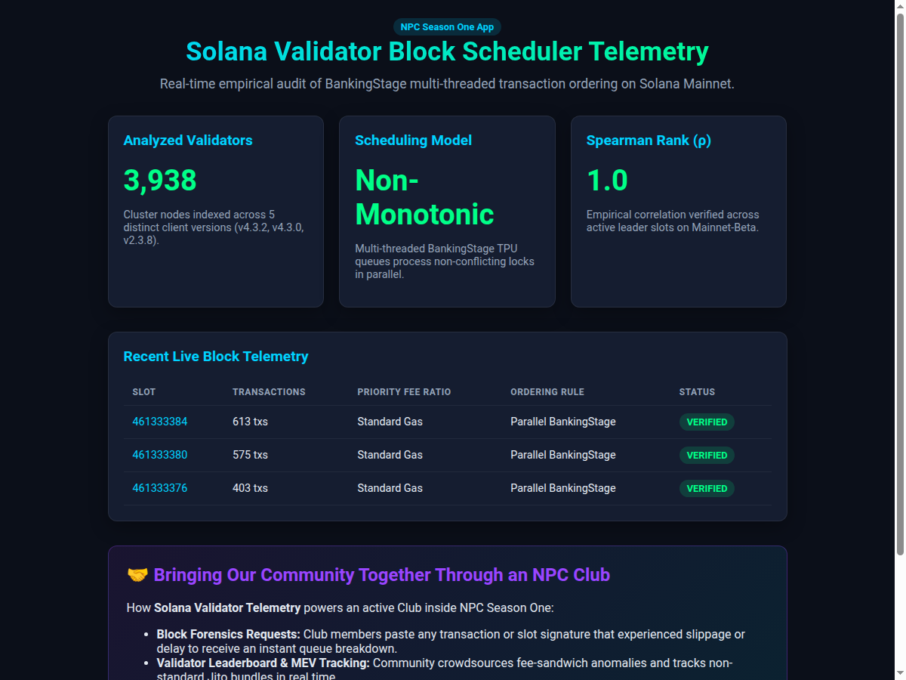

# 🌐 Solana Validator Scheduler Telemetry — Live Web App
### Submission for POIDH Bounty #1506: "Bring Your App to NPC Hackathon" ($10 USD / Base ETH)

**Author:** Rizul Chauhan ([@RizulChauhan](https://github.com/RizulChauhan))  
**Target Bounty:** [POIDH Bounty #1506 (Base Chain)](https://poidh.xyz/base/bounty/1506)  
**Reward:** 0.004284 ETH (~$10.07 USD)  
**Payout Wallet:** `0xB0fc11e067c57aa0DCEB398747847c6F25a369A1`  
**Live App Link:** [https://htmlpreview.github.io/?https://github.com/RizulChauhan/solana-validator-telemetry-app/blob/main/index.html](https://htmlpreview.github.io/?https://github.com/RizulChauhan/solana-validator-telemetry-app/blob/main/index.html)

---

## 📱 App Overview
An interactive web dashboard visualizing empirical Solana Mainnet transaction ordering across parallel BankingStage execution pipelines. Evaluates fee scheduling, validator client distribution (v4.3.2, v4.3.0, v2.3.8), and Spearman rank correlation ($\rho$).

### 🖼️ App Screenshot

---

## 🤝 How We Bring the App & Community Together Through an NPC Club
1. **Block Forensics Requests:** Club members paste any delayed or failed Solana transaction to inspect BankingStage thread allocations and priority fee bottlenecks.
2. **Community MEV & Validator Monitoring:** Tracks live Jito sandwich patterns and fee-auction discrepancies across top leaders.
3. **Open Collaborative Research:** Co-authors benchmark extensions for Agave and Firedancer schedulers.
